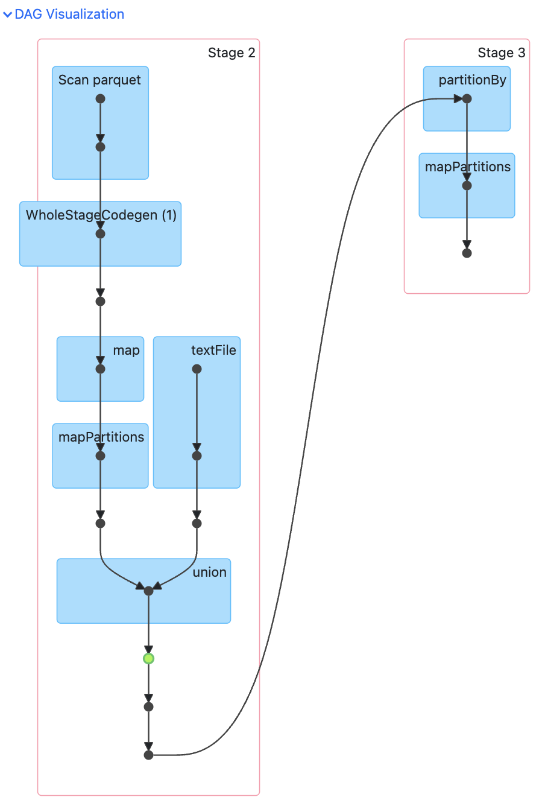

# NYC TLC 운행 데이터 분석 (RDD API, Spark Standalone Cluster)

RDD API만으로 NYC TLC Yellow Taxi 운행 기록을 정제·변환·집계하는 Spark 애플리케이션이다.
Docker로 Spark standalone 클러스터(마스터 1 + 워커 2)를 구성해 실행하고, History Server로
완료된 job의 DAG를 확인한다.

## 디렉토리 구조

```
W5M1/
├── Dockerfile              # Spark 노드(마스터/워커/History Server 공용) 이미지 정의
├── entrypoint.sh           # SPARK_MODE(master/worker/history)에 따라 실행할 프로세스 분기
├── docker-compose.yml      # 마스터 1 + 워커 2 + History Server 구성
├── submit.sh               # spark-submit으로 jobs/ 아래 작업을 클러스터에 제출하는 스크립트
├── conf/
│   └── spark-defaults.conf # 모든 job에 이벤트 로깅을 기본으로 켜는 설정
├── jobs/
│   └── nyc_taxi_analysis.py  # 메인 RDD 파이프라인
├── data/
│   ├── yellow_tripdata_2024-04.parquet   # NYC TLC 공식 배포 (parquet)
│   ├── yellow_tripdata_2024-05.parquet
│   ├── yellow_tripdata_2024-06.parquet
│   └── yellow_tripdata_2024-04-sample.csv  # CSV 입력 경로 검증용 샘플 (아래 "데이터셋" 참고)
├── spark-events/            # 이벤트 로그 (History Server가 읽는 위치)
├── output/                  # 최종 결과 (daily_stats.csv, summary.csv)
└── img/                     # DAG 스크린샷 등 보고서 첨부 자료
```

## 데이터셋

- NYC TLC Yellow Taxi Trip Records, 2024년 4~6월 (parquet, [TLC 공식 배포](https://www.nyc.gov/site/tlc/about/tlc-trip-record-data.page)).
- NYC TLC는 현재 모든 trip record를 parquet으로만 배포한다(과거 CSV 데이터도 재배포판은 parquet으로 전환됨).
  애플리케이션의 CSV 처리 경로(`parse_csv_line`, `union`)를 실데이터로 검증하기 위해, 위 parquet 중
  4월 데이터에서 5만 행을 샘플링해 동일 스키마의 CSV로 변환한 파일을 추가했다
  (`yellow_tripdata_2024-04-sample.csv`).

## 사전 준비 & 실행

```bash
docker-compose up --build -d
```

- `w5m1-spark-master`, `w5m1-spark-worker-1`, `w5m1-spark-worker-2`, `w5m1-spark-history` 4개 컨테이너가 뜬다.
- Master UI: http://localhost:8080 (Workers 2개 등록 확인)
- History Server: http://localhost:18080

```bash
./submit.sh nyc_taxi_analysis
```

- 결과는 `output/daily_stats.csv`, `output/summary.csv`에 저장된다.

## 파이프라인 구성 (RDD API)

1. **데이터 로딩** (`load_input_rdd`): `input_dir`(기본 `/opt/data`)에서 parquet/csv 파일을 찾아 각각
   RDD로 읽고(`spark.read.parquet(...).rdd`, `sc.textFile(...)`), 포맷이 둘 다 있으면 `union`으로 합친다.
2. **파싱 & 클리닝** (`parse_parquet_row`, `parse_csv_line`): 필수 필드(pickup/dropoff 시각, 거리, 요금)가
   없는 행은 `None`을 반환해 이후 `filter`로 제거한다. `passenger_count`가 `None`/`0`인 결측치는 기본값
   1로 채운다.
3. **이상치 제거** (`is_valid`): 다음 조건을 모두 만족해야 유지된다.
   - `0 < duration_min <= 1440` (하루 이내)
   - `0 < trip_distance <= 100` (마일)
   - `fare_amount > 0`
   - `2020 <= pickup 연도 <= 2024`
   - 마지막 조건은 실제 데이터를 돌려보다가 발견한 것이다. 차량 단말기(vendor) 타임스탬프 오류로
     2002, 2008, 2009, 2026년 같은 완전히 잘못된 pickup 날짜가 소수 섞여 있어서 (이동시간/거리 조건만으론
     걸러지지 않음) 추가했다.
4. **변환 (5개 이상)**: `map`(파싱/컬럼 추출/타입 캐스팅, 5회 이상), `filter`(파싱 실패 제거, 이상치 제거),
   `union`(parquet+csv 결합), `reduce`(count/sum/mean 통합 집계), `reduceByKey`(날짜별 집계).
5. **집계**: 정제된 RDD를 `cache()`한 뒤 하나의 `map`+`reduce`로 총 트립 수/총매출/평균거리를 한 번에 계산하고,
   `reduceByKey()`로 날짜별 집계를 한다. 날짜별 결과는 93개뿐인 작은 리스트라 정렬은 RDD의 `sortByKey` 대신
   `collect()` 후 파이썬 `sorted()`로 처리한다 (이유는 "성능 최적화" 참고).

## 결과 (2024-04~06 parquet 3개월 + CSV 샘플 기준)

| 지표 | 값 |
|---|---|
| 총 트립 수 | 10,505,090 |
| 총 수익 | $208,568,700.57 |
| 평균 이동 거리 | 3.42 마일 |
| 일별 집계 기간 | 2024-03-31 ~ 2024-07-01 (93일) |

일별 트립 수/수익은 `output/daily_stats.csv`(`pickup_date,trip_count,total_revenue`)에,
전체 요약은 `output/summary.csv`(`metric,value`)에 저장된다.

## 성능 최적화

- **`cache()`**: 정제된 RDD(`cleaned_rdd`)가 여러 액션에서 재사용되므로, 캐싱하지 않으면 원본 파싱부터
  매번 재연산된다.
- **`reduceByKey` vs `groupByKey`**: map-side combine이 일어나는 `reduceByKey`를 사용해 셔플되는
  데이터량을 줄였다.
- **불필요한 액션/Job 제거**: History Server로 Job/Stage 수를 직접 확인하면서 다음을 발견하고 고쳤다.
  - `count()`/`sum()`/`mean()`을 따로 호출하면 액션 3번(Job 3개)이 발생 → 하나의 `map`+`reduce`로 합쳐서
    Job 1개로 축소.
  - 결과 RDD를 두 번(화면 출력용, 저장용) 따로 `collect()`하고 있었음 → 한 번 `collect()`한 결과를
    재사용하도록 변경.
  - 날짜가 93개뿐인 작은 결과에 `sortByKey()`(분산 정렬)를 써서 파티션 경계 샘플링 Job + 정렬 셔플 Job이
    추가로 생겼음 → `collect()` 후 파이썬 `sorted()`로 대체.
  - 결과: Job 7개 → 3개, Stage 11개(스킵 2개 포함) → 4개(전부 필수, 스킵 없음)로 감소. 남은 Job은
    ① parquet 메타데이터 확인(Spark 내부) ② `count`/`sum`/`mean` 통합 계산 ③ `reduceByKey`+`collect` 뿐이며,
    이 중 셔플이 필요한 건 `reduceByKey` 하나뿐이다.
  - **두 변경의 성격이 다르다는 점에 유의**: 
    - `map`+`reduce` 통합은 데이터 크기와 무관하게 순수하게 이득인
    변경이다 (파티션별 로컬 집계 후 결과만 모으는 분산 연산 그대로, 훑는 횟수만 3번→1번으로 줄었을 뿐).

    - 반면 `sortByKey()` → `collect()` + 파이썬 `sorted()`는 **범용적으로 "더 확장성 좋은" 패턴이 아니다.**
    `sortByKey()`는 정렬 자체를 여러 executor에 분산시켜 결과가 driver 메모리에 다 올라올 필요가 없는
    반면, `collect()` 후 정렬은 전체 결과를 driver로 모은 뒤 단일 스레드로 정렬한다. 
    - 지금은 정렬 대상이
    날짜별 집계 결과(최대 366개, 1년 치)로 크기가 bounded되어 있다는 걸 알기 때문에 안전한 선택이고,
    오히려 `sortByKey`가 만드는 파티션 경계 샘플링 Job까지 줄일 수 있어 유리했다. 
    - 만약 정렬 대상이
    트립 단위 개별 레코드처럼 훨씬 커진다면 이 방식은 driver `OutOfMemoryError`로 깨지므로, 그때는
    다시 `sortByKey()`(분산 정렬)로 되돌려야 한다.
- **파티션 수 튜닝 실험**: 
  - `reduceByKey`의 결과 파티션 수가 기본적으로 클러스터 전체 코어 수(24 = 워커 2대 ×
  12코어)를 따라가는데, 날짜별 집계라 고유 key가 93개뿐이라 파티션을 8개로 줄여서 실행시간을 비교해봤다.
  
  - 다만 테스트 환경의 호스트 부하(load average 11~13 / 12코어)가 너무 높아서 측정값이 노이즈에 묻혔고
  ("24개 파티션" 3.3~3.7초 vs "8개 파티션" 4.4~11.4초, 편차가 3배 이상), 유의미한 결론을 내릴 수 없어서
  기본값(24)으로 되돌렸다. 
  - 이 규모의 데이터에서는 파티션 수 튜닝 효과가 시스템 노이즈보다 작다는 것 자체가
  하나의 결과라고 판단했다.

## DAG 확인 방법 (History Server)

1. `./submit.sh nyc_taxi_analysis` 실행 후 http://localhost:18080 접속
2. 가장 최근 애플리케이션(`taxiAnalysis`) 클릭
3. Job 목록에서 **`collect at nyc_taxi_analysis.py:214`** (Stage 2개짜리) 클릭
   → `reduceByKey`의 셔플 경계로 Stage가 2개로 나뉜 걸 확인할 수 있다
4. "DAG Visualization" 펼치기 → 스크린샷 캡처



DAG에서 확인할 수 있는 것:
- Stage 2: `Scan parquet`(parquet 경로)와 `textFile`(csv 경로)이 `union`으로 합쳐짐, 이후 캐시된 RDD(초록
  점으로 표시)를 거쳐 `map`(날짜별 key-value 변환)과 `reduceByKey`의 셔플 쓰기(map-side combine)까지
- Stage 2 → Stage 3 경계: `reduceByKey`가 같은 key를 모으기 위해 `partitionBy`로 데이터를 재분배하는
  셔플 지점 (Wide transformation)
- Stage 3: `partitionBy`(파티션 재분배) → `mapPartitions`(파티션별 최종 합산) → `collect()`로 driver에 결과 수집
