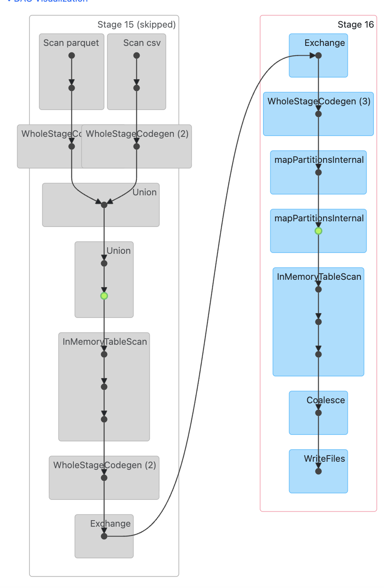

# NYC TLC 운행 데이터 분석 (DataFrame API, Spark Standalone Cluster)

**DataFrame/Spark SQL API**로 NYC TLC Yellow Taxi 운행 기록을 정제·변환·집계하는 Spark 애플리케이션이다.

RDD API로 짠 동일한 파이프라인을 DataFrame API로 다시 구현해, RDD 대비 DataFrame이
스키마·최적화(Catalyst optimizer) 측면에서 어떻게 다른지 비교하는 것이 목적이다. 

Docker로 Spark
standalone 클러스터(마스터 1 + 워커 2)를 구성해 실행하고, History Server로 완료된 job의 DAG를 확인한다.

## 디렉토리 구조

```
W5M2/
├── Dockerfile              # Spark 노드(마스터/워커/History Server 공용) 이미지 정의
├── entrypoint.sh           # SPARK_MODE(master/worker/history)에 따라 실행할 프로세스 분기
├── docker-compose.yml      # 마스터 1 + 워커 2 + History Server 구성
├── submit.sh               # spark-submit으로 jobs/ 아래 작업을 클러스터에 제출하는 스크립트
├── conf/
│   └── spark-defaults.conf # 모든 job에 이벤트 로깅을 기본으로 켜는 설정
├── jobs/
│   └── nyc_taxi_analysis.py  # 메인 DataFrame 파이프라인
├── data/
│   ├── yellow_tripdata_2024-04.parquet   # NYC TLC 공식 배포 (parquet)
│   ├── yellow_tripdata_2024-05.parquet
│   ├── yellow_tripdata_2024-06.parquet
│   ├── yellow_tripdata_2024-04-sample.csv  # CSV 입력 경로 검증용 샘플
│   └── lookup/
│       └── taxi_zone_lookup.csv  # 자치구(Borough) 조인용 참조 테이블 (아래 "데이터셋" 참고)
├── spark-events/            # 이벤트 로그 (History Server가 읽는 위치)
├── output/                  # 최종 결과 (daily_stats.csv, summary.csv, borough_stats/)
└── img/                     # DAG 스크린샷 등 보고서 첨부 자료
```

## 데이터셋

- NYC TLC Yellow Taxi Trip Records, 2024년 4~6월 (parquet, [TLC 공식 배포](https://www.nyc.gov/site/tlc/about/tlc-trip-record-data.page)).
- CSV 처리 경로(명시적 스키마 지정)를 실데이터로 검증하기 위해, 위 parquet 중 4월 데이터에서 5만 행을
  샘플링해 동일 스키마의 CSV로 변환한 파일을 추가했다 (`yellow_tripdata_2024-04-sample.csv`).
- **Taxi Zone Lookup** (`data/lookup/taxi_zone_lookup.csv`): TLC가 트립 데이터와 함께 공식 배포하는
  `LocationID → Borough/Zone/service_zone` 참조 테이블 ([공식 배포 경로](https://d37ci6vzurychx.cloudfront.net/misc/taxi_zone_lookup.csv)).
  트립 데이터의 `PULocationID`와 조인해 자치구별 집계에 사용한다. `data/` 최상위가 아니라 `data/lookup/`
  하위에 둔 이유는, `load_input_data`가 `input_dir` 최상위의 `*.csv`를 전부 트립 데이터로 간주해
  `CSV_SCHEMA`로 읽으려 하기 때문이다 — 최상위에 두면 컬럼 수가 안 맞아 파싱이 깨진다.

## 사전 준비 & 실행

```bash
docker-compose up --build -d
```

- `w5m2-spark-master`, `w5m2-spark-worker-1`, `w5m2-spark-worker-2`, `w5m2-spark-history` 4개 컨테이너가 뜬다.
- Master UI: http://localhost:8080 (Workers 2개 등록 확인)
- History Server: http://localhost:18080

```bash
./submit.sh nyc_taxi_analysis
```

- 결과는 `output/daily_stats.csv`, `output/summary.csv`, `output/borough_stats/`(Spark `write` 결과,
  디렉토리 안에 `part-*.csv`로 저장됨)에 저장된다.

## 파이프라인 구성 (DataFrame API)

1. **데이터 로딩** (`load_input_data`): `input_dir`(기본 `/opt/data`)에서 parquet/csv 파일을 찾아
   각각 DataFrame으로 읽는다.
   - parquet: `spark.read.parquet(*paths)` — parquet은 파일 자체에 스키마가 박혀있어 자동으로 추론된다.
   - csv: `spark.read.schema(CSV_SCHEMA).option("header", True).csv(paths)` 
     - `CSV_SCHEMA`는 parquet 스키마(pyarrow로 직접 확인)와 컬럼명·타입을 맞춘 `StructType`으로, RDD 버전의 수동 파싱 (`parse_csv_line`)을 대체한다.
   - 두 포맷이 모두 있으면 `unionByName`으로 합친다 
2. **클리닝** (`main`의 `na.drop` + `withColumn`):
   - `na.drop(subset=[...])`으로 pickup/dropoff 시각, 거리, 요금 중 하나라도 결측이면 제거.
   - `passenger_count`가 null 또는 0이면 `F.when/otherwise`로 기본값 1 채움.
   - `duration_min`(분 단위 소요시간), `pickup_date`(날짜 문자열)를 `withColumn`으로 파생.
3. **이상치 제거** (`is_valid`): `filter()` 하나로 다음 조건을 동시에 적용 — `0 < duration_min <= 1440`,
   `0 < trip_distance <= 100`, `fare_amount > 0`, `2020 <= pickup 연도 <= 2024`.
4. **변환 (3종 이상)**:
   - **Filtering**: `passenger_count > 1`인 트립만 남기는 `multi_passenger_df`.
   - **Aggregation**: `groupBy("pickup_date").agg(count, sum, avg)`로 날짜별 집계 (`daily_df`).
   - **Join**: `cleaned_df.join(zone_df, PULocationID == LocationID, "left")` 후
     `groupBy("Borough")`로 자치구별 트립 수/매출 집계 (`borough_df`). `zone_df`도 `inferSchema=True` 대신
     `ZONE_SCHEMA`(작은 `StructType`)를 명시해서 읽는다 — 이유는 아래 "성능 최적화" 참고.
5. **액션 (2종 이상)**:
   - **Collect**: 전체 요약 통계, 날짜별 통계, 자치구별 통계를 각각 `.collect()`로 driver에 모아 출력.
   - **Write**: 자치구별 결과는 `borough_df.coalesce(1).write.mode("overwrite").option("header", True).csv(...)`로
     Spark의 `DataFrameWriter`를 통해 직접 저장 (날짜별/요약 결과는 이미 driver에 모은 리스트를
     파이썬 `open()`으로 단일 파일에 써서 `daily_stats.csv`/`summary.csv`라는 고정 파일명을 유지).

## Lazy Evaluation 확인

`withColumn`, `filter`, `groupBy`, `join` 등은 전부 **transformation**이라 호출 시점엔 아무 계산도
일어나지 않는다 (Spark UI에 Job이 하나도 안 뜬다). 

실제 계산은 `.collect()`나 `.write()`처럼
**action**을 호출하는 순간에만 트리거된다 

History Server에서 Job 목록의 타임스탬프를 보면,
`cleaned_df = cleaned_df.filter(...)`류의 코드가 실행된 시점이 아니라 `.agg(...).collect()`가
호출된 시점에 Job이 생성되는 것을 확인할 수 있다.

## 성능 최적화

- **`cache()`**: 정제된 `cleaned_df`가 (1) 전체 요약 집계, (2) 승객수 필터 집계, (3) 날짜별 집계,
  (4) 자치구 조인 집계까지 총 4곳에서 재사용되므로, 캐싱하지 않으면 매 액션마다 원본 파싱부터
  다시 실행된다.
- **집계 통합**: 총 트립 수/총 매출/평균 거리를 `count()`/`sum()`/`agg()`로 각각 따로 호출하면
  액션 3번(Job 3개)이 생긴다. `cleaned_df.agg(F.sum(...), F.sum(...), F.count("*"))` 하나로 합쳐서
  Job 1개로 줄였다 — RDD 버전에서 `map`+`reduce`를 하나로 합친 것과 같은 원리다.
- **서로 다른 `agg()` 결과를 `union` 후 한 번에 `collect()`**: "전체 통계"와 "승객수 필터 통계"를
  각각 `agg().collect()`로 부르면 액션이 2번(Job 2개)이었다. 두 결과 모두 1행짜리 DataFrame이라
  `unionByName`으로 합친 뒤 `collect()`를 한 번만 호출하도록 바꿔서 액션 1개로 줄였다 — `filter()`
  변환 자체(`multi_passenger_df`)는 그대로 유지하면서, 그 결과를 소비하는 액션만 통합한 것이 포인트다.
- **`unionByName` vs `union`**: 컬럼 이름 기준으로 합쳐서, parquet과 CSV의 컬럼 순서가 혹시
  달라지더라도 안전하게 합쳐지도록 했다.
- **`borough_df`도 캐싱**: 처음엔 `borough_df`(조인+`groupBy` 결과)를 캐싱하지 않고 `collect()`와
  `write()` 두 액션에 그대로 썼더니, History Server에 **조인+집계 전체가 두 번(각각 5개 안팎의
  Job으로 쪼개져서) 실행되는 게** 그대로 찍혔다 — Job 목록에 같은 소스 라인(`collect()` 호출부)이
  똑같은 skip 패턴으로 두 번 반복되는 걸로 확인. `borough_df.cache()`를 추가해서 `write()`가
  `collect()`가 이미 계산해둔 결과를 재사용하도록 고쳤다.
- **`orderBy()` 대신 파이썬 `sorted()`**: 자치구는 많아야 10개 안팎인데 `borough_df.orderBy(...)`로
  분산 정렬을 하면 경계 샘플링 Job + 셔플 정렬 Job이 추가로 생긴다. `daily_sorted`와 똑같은 이유로,
  `orderBy()`를 빼고 `collect()` 후 파이썬 `sorted(..., key=lambda row: row.trip_count, reverse=True)`로
  바꿨다.
- **`inferSchema=True` 제거**: `zone_df`를 `inferSchema=True`로 읽으면 스키마를 알아내기 위해 파일을
  한 번 더 스캔하는 Job(History Server에 `csv at NativeMethodAccessorImpl.java:0`로 표시됨)이 추가로
  생긴다. `ZONE_SCHEMA`를 명시해서 이 Job을 없앴다.
- **Job 개수 자체에 대한 참고**: History Server에는 액션(`collect`/`write`) 하나당 최소 1개 이상의
  Job이 생기고, `groupBy`/`join`처럼 셔플이 있는 연산은 Adaptive Query Execution(AQE)이 셔플 전/후
  단계를 나눠 처리하느라 액션 하나가 여러 개의 Job으로 쪼개지기도 한다. 그래서 Stage/Job 총개수가
  많아 보여도 대부분 `skipped`(회색, 캐시 재사용)로 표시된다면 실제 비용은 크지 않다 — 최적화
  여부를 판단할 땐 총 개수보다 **실제로 실행(파란색)된 Stage의 소요 시간**을 봐야 한다.

## DAG 확인 방법 (History Server)

1. `./submit.sh nyc_taxi_analysis` 실행 후 http://localhost:18080 접속
2. 가장 최근 애플리케이션(`taxiAnalysis`) 클릭
3. Job 목록에서 `groupBy`/`join`이 포함된 Job(Stage가 여러 개로 나뉜 것)을 클릭
   → 셔플 경계로 Stage가 나뉜 걸 확인할 수 있다
4. "DAG Visualization" 펼치기 → 스크린샷 캡처해서 `img/dag_screenshot.png`로 저장



캡처한 DAG는 `borough_stats` 저장(`write`) 액션의 실행 계획이다. 왼쪽 회색 Stage(Stage 15,
skipped)는 `cleaned_df`가 이미 캐시돼 있어 재계산 없이 `InMemoryTableScan`(초록 점)으로 바로
읽히는 부분 — parquet/csv 스캔과 `union`을 포함한 전체 정제 과정이 스킵된 걸 보여준다. 오른쪽
파란 Stage(Stage 16)가 `Exchange`(셔플 경계, `groupBy("Borough")`) 이후 실제로 실행된 부분이며,
`Coalesce` → `WriteFiles`로 끝나는 게 `borough_df.coalesce(1).write...csv(...)` 호출이다.

## 결과 (2024-04~06 parquet 3개월 + CSV 샘플 기준)

| 지표 | 값 |
|---|---|
| 총 트립 수 | 10,505,090 |
| 총 수익 | $208,568,700.57 |
| 평균 이동 거리 | 3.42 마일 |
| 일별 집계 기간 | 2024-03-31 ~ (93일, `output/daily_stats.csv`) |

자치구(Borough)별 트립 수 (`output/borough_stats/part-*.csv`, join 결과):

| Borough | 트립 수 | 총 매출 |
|---|---|---|
| Manhattan | 9,351,498 | $152,480,504.53 |
| Queens | 937,647 | $49,954,373.41 |
| Brooklyn | 149,477 | $4,248,940.83 |
| Bronx | 31,644 | $1,018,327.47 |
| Unknown | 31,705 | $657,731.98 |
| N/A | 2,434 | $170,762.69 |
| EWR | 324 | $26,260.46 |
| Staten Island | 361 | $11,799.20 |

압도적으로 Manhattan이 전체 트립의 약 89%를 차지한다 — Yellow Taxi가 맨해튼 중심으로 운행된다는
사실과 일치하며, 8개 자치구 트립 수 합계(9,351,498+937,647+...+361 = 10,505,090)가 전체 총 트립
수와 정확히 일치해 join이 트립을 누락/중복 없이 처리했음을 확인할 수 있다.
