# DE : Optimizing Spark Jobs

## 아파치 스파크 최적화의 두 축

1. **각 태스크 내에서의 연산 효율성**
2. 클러스터 내 데이터 이동

<br>

## Optimizing Spark Jobs

### DataFrame 대신 RDD를 사용해야 하는 경우

- 더 높은 수준의 API와 최적화 기능을 제공하므로, 일반적으로 DataFrame이 사용하기 더 쉽고 더 나은 성능을 제공한다.
- 그러나 더 낮은 수준의 특성 때문에, RDD는 사용자 정의 연산을 정의하거나 복잡한 데이터 처리 작업을 디버깅하는 데 여전히 유용하다.
- RDD는 파티셔닝과 메모리 사용에 대해 더 세밀한 제어를 제공한다.
- 텍스트 스트림, 바이너리 파일 또는 사용자 정의 형식과 같은 원시 비정형 데이터를 다룰 때, 사전에 정의된 구조가 없으므로 RDD는 사용자 정의 파싱 및 데이터 조작을 수행할 수 있어 더 유연하다.

<br>

### 효율적인 파일 형식과 압축 codec 사용

- 사용하는 파일 형식과 압축 codec은 I/O 및 전체 Spark 성능에 상당한 영향을 미친다.
- Apache Parquet 또는 Apache ORC와 같이 Spark에 최적화된 파일 형식과 Snappy 또는 LZ4와 같은 빠른 압축 코덱을 사용하면 읽고 쓰는 데이터의 양을 줄이고 Spark 애플리케이션의 성능을 향상시킬 수 있다.

<br>

### Row-Based Storage 대비 Columnar Storage의 장점

- **압축 효율성**: Columnar Storage은 더 효율적인 압축 기법을 사용할 수 있다. 동일한 열의 값들은 대부분 같은 데이터 타입이므로, 해당 타입에 맞는 압축 알고리즘을 적용하여 더 높은 압축률을 얻을 수 있다. 이를 통해 저장 공간을 절약하고 데이터 전송 속도를 향상시킬 수 있다.
- **Column Pruning**: 쿼리를 실행할 때 필요한 열만 읽고 불필요한 열은 건너뛸 수 있어 I/O를 줄이고 쿼리 성능을 향상시킨다. 반면, Row-Based Storage은 일부 열만 필요하더라도 전체 행을 읽어야 한다.
- **Aggregation Performance**: Columnar Storage은 집계 연산이 단일 열을 대상으로 수행되므로 집계 쿼리를 매우 효율적으로 처리할 수 있다. 따라서 분석 작업에서 더 빠른 쿼리 성능을 제공한다.
- **Predicate Pushdown**: 메타데이터를 분석하여 쿼리 실행 초기에 필터를 적용할 수 있으므로 저장소에서 읽어야 하는 데이터의 양을 최소화할 수 있다. 이 기능은 쿼리 처리 속도를 크게 향상시킨다.
- **Schema Evolution**: Parquet와 같은 Columnar Storage은 스키마 진화를 지원하므로 기존 데이터를 손상시키지 않고 새로운 열을 추가하거나 기존 열의 구조를 변경할 수 있다.

<br>

### Relational DB vs Data Warehouse

| 구분 | Amazon RDS | Amazon Redshift |
| --- | --- | --- |
| **목적(Purpose)** | OLTP(트랜잭션 처리) | OLAP(분석) |
| **데이터 구조(Data Structure)** | 행 기반 저장(Row-based storage) | 열 기반 저장(Columnar storage) |
| **쿼리 성능(Query Performance)** | 소규모 트랜잭션 처리에 빠름 | 대규모 분석에 최적화됨 |
| **확장성(Scaling)** | 수직 확장 + 읽기 전용 복제본(Read Replicas) | 수평 확장(MPP 아키텍처) |
| **사용 사례(Use Case)** | 애플리케이션, 웹사이트, CRM, ERP | 비즈니스 인텔리전스, 데이터 분석, 리포팅 |
| **데이터베이스 엔진(Database Engines)** | MySQL, PostgreSQL, Oracle, SQL Server, Aurora | Amazon Redshift(PostgreSQL 기반) |
| **최적화 대상(Optimized For)** | 실시간 트랜잭션 | 배치 처리 및 분석 |
| **데이터 규모(Data Size)** | GB ~ TB | TB ~ PB |

<br>

## Data Warehouse vs Data Lake vs Lake House

### Data Warehouse

: 더 나은 의사결정을 내리기 위해 분석할 수 있는 정보를 중앙에서 저장하는 저장소

데이터는 일반적으로 정기적인 주기에 따라 트랜잭션 시스템, 관계형 데이터베이스 및 기타 다양한 소스로부터 데이터 웨어하우스로 유입된다. Business analysts, data engineers, data scientists 및 decision makers는 business intelligence(BI) 도구, SQL clients 및 기타 분석 애플리케이션을 통해 이 데이터에 접근한다.

<br>

### Data Lake

: 모든 정형 및 비정형 데이터를 어떠한 규모에서도 저장할 수 있도록 하는 중앙 집중식 저장소

- **데이터를 미리 구조화할 필요 없이** 원본 그대로 저장할 수 있으며, 대시보드와 시각화부터 빅데이터 처리, 실시간 분석, 머신러닝에 이르기까지 다양한 형태의 분석을 수행하여 더 나은 의사결정을 지원할 수 있다.

<br>

### Data Lakehouse

: 데이터 레이크의 유연성, 비용 효율성, 확장성과 데이터 웨어하우스의 데이터 관리 기능 및 ACID 트랜잭션을 결합한 개방형 데이터 관리 아키텍처

- Data Lakehouse는 데이터 레이크와 데이터 웨어하우스의 장점을 결합한 새로운 개방형 아키텍처이다.
- Data Lakehouse는 저비용의 클라우드 스토리지 위에서 개방형 포맷을 사용하여 데이터 웨어하우스와 유사한 데이터 구조 및 데이터 관리 기능을 직접 구현하는 새로운 시스템 설계를 통해 구현된다.
- Data Lakehouse는 저렴하고 매우 안정적인 스토리지(객체 스토리지 형태)를 사용할 수 있는 현대 환경에 맞추어 데이터 웨어하우스를 새롭게 설계한다면 만들어질 형태라고 할 수 있다.

<br>

### Data Warehouse vs Data Lake vs Lake House


| 구분 | Data Warehouse | Data Lake | Lakehouse |
| --- | --- | --- | --- |
| **주요 목적 (Primary Purpose)** | BI 및 OLAP 쿼리에 최적화된 **정형 데이터**의 중앙 저장소 | **모든 데이터 유형**(정형, 반정형, 비정형)을 **원시 또는 최소한으로 처리된 형태**로 저장 | 데이터 웨어하우스의 성능·거버넌스와 데이터 레이크의 유연성·확장성을 결합 |
| **데이터 구조 및 스키마 (Data Structure & Schema)** | **Schema-on-write**(사전 정의된 스키마) | **Schema-on-read**(분석 시점에 스키마 적용) | 일반적으로 **Schema-on-read + ACID 트랜잭션**(Delta, Hudi, Iceberg 등의 테이블 포맷 사용) |
| **데이터 유형 (Types of Data)** | 주로 **정형 데이터** | **정형, 반정형, 비정형 데이터**(텍스트, 이미지, 로그 등) | 데이터 레이크와 동일한 범위를 지원하면서 데이터 웨어하우스 수준의 쿼리 성능과 트랜잭션 일관성을 제공 |
| **데이터 거버넌스 및 품질 (Data Governance & Quality)** | 엄격한 ETL을 통해 관리되는 **정제된 데이터** | 거버넌스가 비교적 느슨하며 적절한 관리가 없으면 **데이터 스웜프(Data Swamp)** 가 되기 쉬움 | 단일 플랫폼에서 **거버넌스(ACID, 버전 관리, 계보 추적)** 와 정제된 데이터를 강조 |
| **분석 성능 (Analytics Performance)** | 집계 및 리포팅에 높은 성능 제공 | Spark, Presto 등의 빅데이터 엔진을 활용한 대규모 분석에 적합하며 원시 데이터 형식에 따라 성능이 달라질 수 있음 | 캐싱, 인덱싱, 쿼리 가속 등의 기능을 통해 **데이터 웨어하우스 수준의 성능**을 제공하도록 설계됨 |
| **비용 및 확장성 (Cost & Scalability)** | 일반적으로 규모가 커질수록 비용이 높으며 컴퓨팅과 스토리지가 밀접하게 결합됨 | 일반적으로 저장 비용이 낮고(클라우드 객체 스토리지), 사용한 만큼 컴퓨팅 비용을 지불함 | 저비용 객체 스토리지와 필요 시 확장되는 컴퓨팅을 결합하여 데이터 레이크와 데이터 웨어하우스를 연결함 |
| **대표 제품 (Representative Vendors)** | Redshift, Snowflake, BigQuery | Amazon S3, ADLS, GCS + 데이터 카탈로그 | 객체 스토리지 + Iceberg, Delta Lake 또는 Hudi + 쿼리 엔진 |
| **등장 시기 (Approx. Emergence)** | **1980년대** – Barry Devlin과 Bill Inmon(데이터 웨어하우스의 아버지)이 개념을 정립하였으며, 1990년대 OLAP 및 BI의 확산과 함께 널리 보급됨 | **2010년대 초반** – James Dixon(Pentaho)이 'Data Lake'라는 용어를 대중화하였으며, AWS S3 등 클라우드 객체 스토리지의 보급과 함께 확산됨 | **2010년대 후반** – Databricks가 'Lakehouse Architecture' 개념을 제시·대중화하였으며, Delta Lake, Apache Hudi, Apache Iceberg 등의 발전과 함께 빠르게 확산됨 |

<br>

### Apache Parquet vs Other Formats

- Parquet는 **WORM(Write Once Read Many, 한 번 쓰고 여러 번 읽기)** 환경에 최적화되어 있다.
    - 쓰기 속도는 느리지만 읽기 속도는 매우 빠르며, 특히 전체 컬럼 중 일부 컬럼만 조회하는 경우 뛰어난 성능을 제공한다.
- 전체 레코드를 자주 처리하거나 교환하는 작업에서는 Avro와 같은 **Row-oriented** 형식이 더 적합할 수 있다. CSV와 JSON은 일반적으로 성능보다는 상호운용성과 가독성을 위해 선택된다.

| 속성 | CSV | JSON | Parquet |
| --- | --- | --- | --- |
| 컬럼형(Columnar) | 아니오 | 아니오 | 예 |
| 압축 가능(Compressible) | 예 | 예 | 예 |
| 분할 가능(Splittable) | 예 | 예 | 예 |
| 사람이 읽을 수 있음(Human Readable) | 예 | 예 | 아니오 |
| 중첩 가능(Nestable) | 아니오 | 예 | 예 |
| 복잡한 데이터 구조(Complex Data Structures) | 아니오 | 예 | 예 |
| 기본 스키마: 이름 있는 컬럼(Default Schema: Named columns) | 수동 | 자동(전체 읽기) | 자동(즉시) |
| 기본 스키마: 데이터 타입(Default Schema: Data Types) | 수동(전체 읽기) | 자동(전체 읽기) | 자동(즉시) |

<br>

### Apache Spark와 JVM

- Spark는 주로 Scala로 작성되며 Java 가상 머신(JVM)에서 실행된다.
- PySpark는 Python 코드를 실행해야 할 때 추가적으로 Python 워커 프로세스를 사용한다.

스파크는 메모리 전용 처리 엔진이 아님

메모리를 작업 영역으로 사용하고 영속화된 블록을 LRU 캐시로 관리한다.

<br>

### LRU 캐시

- 가장 최근에 사용되지 않은 캐시
- 새로운 데이터를 위한 공간을 만들기 위해 가장 최근에 사용되지 않은 데이터를 선택하여 제거
- 캐시 내 데이터의 우선순위는 그 데이터의 필요성에 따라 변한다.


<br>

### On Heap Memory

- **Storage Memory**: 주로 RDD 캐시, 언롤 데이터 등과 같은 스파크 캐시 데이터를 저장하는 데 사용
- **Execution Memory**: 주로 셔플, 조인, 정렬, 집계 등의 계산 과정에서 임시 데이터를 저장하는 데 사용
- **User Memory**: 주로 RDD 종속성 정보와 같은 RDD 변환 작업에 필요한 데이터를 저장하는 데 사용
- **Reserved Memory**: 시스템을 위해 예약되며 스파크의 내부 객체를 저장하는 데 사용


<br>

### If your executor memory is 5 GB,

- spark.executor.memory = 5 GB = 5120MB
- default memory overhead = max(10% of spark.executor.memory, 384 MB)
    - max(5 GB * 1024 MB * 0.1, 384 MB) = max(512 MB, 384 MB) = 512 MB
- YARN/Kubernetes executor 컨테이너: 5120 + 512 = 5632 MB
- heap space: 5120MB
    - **reserved memory = 300 MB**
    - heap space - reserved memory = 5120 - 300 = 4820 MB
    - **spark.memory.fraction = 0.6 (default)**
        - 4820 MB * 0.6 = 2892 MB
    - **spark.memory.storageFaction = 0.5 (default)**
        - 2892 MB * 0.5 = 1446 MB
    - **user memory** = (1- spark.memory.fraction) * 4820 MB = 1928 MB

<br>

## 아파치 스파크 최적화의 두 축

1. 각 태스크 내에서의 연산 효율성
2. **클러스터 내 데이터 이동**

<br>

### Use SparkSQL

- 데이터를 필터링, 그룹화, 또는 집계해야 하는 경우 SparkSQL을 사용하여 쿼리를 더 효과적으로 표현한다. 대부분의 경우 SparkSQL은 셔플을 줄이고 이러한 쿼리의 실행을 개선할 수 있다.
- SparkSQL은 원본 데이터의 스키마를 자동으로 보존하는 Parquet 파일의 읽기와 쓰기 모두를 지원한다.

<br>

### Shuffle in Spark

- 셔플은 동일한 파티셔닝 키를 가진 데이터가 동일한 출력 파티션에 도달하도록 레코드를 재분배하는 것
- 조인, 집계, 중복 제거, 정렬, 재파티셔닝과 같은 작업들은 이러한 재분배를 필요로 할 수 있다.
- 셔플은 넓은 종속성을 생성하며 일반적으로 계산을 서로 다른 스테이지로 분리한다.

<br>

### Data shuffling is a performance killer

- Data shuffling은 노드 간 데이터 이동에 따른 네트워크 데이터 전송, 높은 디스크 I/O, 파일 재배열 작업을 유발하기 때문에 비용이 많이 드는 프로세스이다.
- 스파크 애플리케이션의 성능은 이러한 요소들을 인지하고 가능한 한 셔플링을 피함으로써 향상될 수 있다.

<br>

### Causes of Shuffle

- 일반적으로 셔플을 유발하는 작업들
    - groupBy, groupByKey, reduceByKey, 그리고 키별 집계
    - 입력 데이터가 이미 호환 가능한 파티셔닝을 가지고 있지 않은 경우의 조인
    - distinct, 전역 정렬, 그리고 많은 윈도우 작업들
    - repartition()과 repartitionByRange()
- 셔플을 더 비용이 많이 들게 만드는 조건들
    - Data skew
    - 너무 적거나 너무 많은 셔플 파티션
    - 큰 레코드나 넓은 행
    - 느린 디스크, 제한된 네트워크 대역폭, 또는 불충분한 실행 메모리

<br>

### Transformation Optimization

- 각 파티션 내에서 지역 정렬만 필요한 경우 sortWithinPartitions()를 사용.
    - 이는 전역적으로 정렬된 결과를 생성하지 않는다.
- 후속 작업들이 범위 기반 파티셔닝의 이점을 얻는 경우 repartitionByRange()를 사용.
    - 이 작업은 셔플을 수행한다.
- 각 범위 파티션 내에서 정렬된 레코드가 필요한 경우, sortWithinPartitions()를 뒤이어 사용한다.
- **Filter early**: 비용이 많이 드는 조인, 윈도우, 집계 작업 이전에 행의 수를 줄인다.
- **Project early**: 후속 작업에 필요한 열만 유지한다.
- **Use built-in aggregate functions:** 이들은 부분 집계를 지원하며 일반적으로 키에 대한 모든 값을 수집하는 것보다 선호된다.
- **Treat window functions as expensive**: 파티셔닝과 정렬 요구사항은 일반적으로 셔플과 정렬 작업을 유발한다.
- 작업이 셔플이 없다고 가정하기보다는 explain()으로 실제 계획을 확인한다.

<br>

### Caching in Spark

```python
df.cache()
```

- 캐싱은 계산 실행 및 데이터 저장과 같은 작업을 수행하는 스파크 워커 노드의 메모리 자원을 활용하기 때문에 신중한 계획이 필요하다는 점을 명심하는 것이 중요하다.
- 데이터셋이 사용 가능한 메모리보다 상당히 크거나, 후속 단계에서 재사용하지 않으면서 RDD나 데이터프레임을 캐싱하는 경우, 잠재적인 오버플로우와 다른 메모리 관리 문제들이 성능 병목을 유발할 수 있다.


<br>

### Persist in Spark

- cache()는 API의 기본 저장 수준을 사용하는 persistence의 축약형
- persist(storageLevel)은 특정 저장 수준을 선택할 수 있게 해준다.
- RDD의 경우, 기본값은 MEMORY_ONLY이다.
- 데이터프레임의 경우, 기본값은 MEMORY_AND_DISK_DESER이다.

```python
val rdd = sc.textFile("hdfs://...")
val processedRdd = rdd.map(...).filter(...)

// Persist the processed RDD in memory
processedRdd.persist()

// Perform multiple actions on the persisted RDD
processedRdd.count()
processedRdd.collect()
```

<br>

### RDD Persistence

| Storage Level | Description | Not available in Python |
| --- | --- | --- |
| MEMORY_ONLY | RDD를 JVM 힙에 역직렬화된 자바 객체로 저장한다. 메모리에 맞지 않는 파티션은 필요할 때 재계산된다. |  |
| MEMORY_ONLY_SER | RDD를 JVM 메모리에 직렬화된 객체로 저장한다. 이는 메모리 사용량을 줄이지만 데이터에 접근할 때 역직렬화를 필요로 한다. | X |
| MEMORY_AND_DISK | RDD를 메모리에 역직렬화된 객체로 저장하고 메모리에 맞지 않는 파티션은 디스크에 저장한다. |  |
| MEMORY_AND_DISK_SER | MEMORY_AND_DISK와 유사하지만, RDD를 메모리에 직렬화된 객체로 저장한다. | X |
| DISK_ONLY | RDD를 디스크에만 저장하고 필요할 때 읽어들인다. |  |
| OFF_HEAP | RDD를 직렬화된 형태로 JVM 힙 외부에 저장한다. 오프힙 메모리는 별도로 활성화되고 구성되어야 한다. |  |
- _SER는 데이터가 메모리에 저장되는 방식을 나타내며, 디스크에 기록되는 데이터는 어느 경우든 직렬화된다.

<br>

### Persist를 사용해야 할 때

- 동일한 데이터셋에 대해 반복적인 작업을 수행하는 작업이 있을 때 persist를 사용한다.
- persist가 없으면, 스파크의 각 액션은 RDD를 처음부터 재계산하는데, 이는 RDD가 크고 계산이 복잡한 경우 비효율적일 수 있다.
- Persistence는 데이터셋이 첫 번째 액션에 의해 구체화된 이후 repeated lineage computation을 방지한다.

<br>

### Checkpoint in Spark

- checkpoint method는 RDD의 lineage를 잘라내는 데 사용
    - 스파크가 **RDD를 신뢰할 수 있는 저장소(HDFS, S3 등)에 저장**하고, 그 시점부터는 스파크가 원본 소스에서 재계산하는 대신 체크포인트된 파일에서 RDD를 읽는다는 것을 의미
- 실패의 위험이 있고 처음부터 RDD를 재계산하는 것이 비용이 많이 드는 **장기 실행 작업에 유용**

```python
val rdd = sc.textFile("hdfs://...")
val processedRdd = rdd.map(...).filter(...)

// Checkpoint the processed RDD
sc.setCheckpointDir("/path/to/checkpoint/dir")
processedRdd.checkpoint()

// Action to trigger the checkpoint
processedRdd.count()
```

<br>

### Checkpoint를 사용해야 할 때

- 계산의 중간 단계를 재계산하는 데 비용이 많이 드는 작업이 있는 경우
- 작업이 재시작될 수 있는 노드 장애나 다른 문제들의 위험이 있는 경우
- Checkpointing은 **RDD transformations의 lineage를 끊음**으로써 결함 허용성을 보장하는 데 도움이 된다.

<br>

### Cache vs Checkpoint

- 캐시는 RDD를 구체화하여 메모리(및/또는 디스크)에 보관한다.
    - 하지만 RDD의 lineage(computing chain, 즉 그 RDD를 생성한 일련의 연산들)는 기억되므로, 노드 장애가 발생하여 캐싱된 RDD의 일부가 손실되더라도 재생성될 수 있다.
- 체크포인트는 RDD를 HDFS 파일에 저장하고 lineage를 완전히 잊어버린다.
    - 이는 long lineage를 잘라낼 수 있게 하고 복제를 통해 자연스럽게 결함 허용성을 갖는 HDFS에 데이터를 안정적으로 저장할 수 있게 한다.

<br>

### Combining Persist and Checkpoint

```python
val rdd = sc.textFile("hdfs://...")
val processedRdd = rdd.map(...).filter(...)

// Persist the processed RDD in memory
processedRdd.persist()

// Checkpoint the processed RDD
sc.setCheckpointDir("/path/to/checkpoint/dir")
processedRdd.checkpoint()

// Action to trigger the persist and checkpoint
processedRdd.count()
```

<br>

### Data Partitioning in Spark

- 스파크는 데이터 소스와 작업에 기반하여 초기 파티션 수를 결정한다. 또한 선택한 키나 파티션 수에 의해 데이터를 재파티셔닝하는 옵션도 제공한다.
- 병렬 처리의 효율성에 영향을 미치는 가장 중요한 요소 중 하나는 파티션의 수이다.
    - 파티션이 충분하지 않으면, 사용 가능한 메모리와 자원이 충분히 활용되지 못할 수 있다.
    - 반면에, 파티션이 너무 많으면 태스크 스케줄링과 조정으로 인한 성능 오버헤드가 증가할 수 있다.
    - 최적의 파티션 수는 데이터 크기, 작업, 그리고 사용 가능한 클러스터 자원에 따라 달라진다.

<br>

### repartition() and coalesce()

```python
df = df.repartition(200) # repartition method
df = df.coalesce(200) # coalesce method
```

- repartition() 메소드는 RDD나 데이터프레임의 파티션 수를 늘리거나 줄이며 클러스터 전반에 걸쳐 데이터의 전체 셔플을 수행
    - 처리 및 네트워크 지연 측면에서 비용이 많이 들 수 있다.
- coalesce() 메소드는 RDD나 데이터프레임의 파티션 수를 줄임
    - repartition()과는 달리 전체 셔플을 수행하지 않고, 대신 인접한 파티션을 결합하여 전체 파티션 수를 줄인다.

<br>

### Handling Data Skews

- **Partitioning**
    - 데이터를 적절히 파티셔닝하면 노드 전반에 걸쳐 작업 부하를 고르게 분산하는 데 도움이 될 수 있다.
- **Sampling**
    - 샘플링 기법을 사용하여 편중된 키를 식별하고 커스텀 파티셔닝이나 필터링 전략을 적용한다.
- **Aggregation**
    - data skew의 영향을 줄이기 위해 사전 집계나 부분 집계와 같은 대안적인 집계 전략을 사용한다.

<br>

### Salting

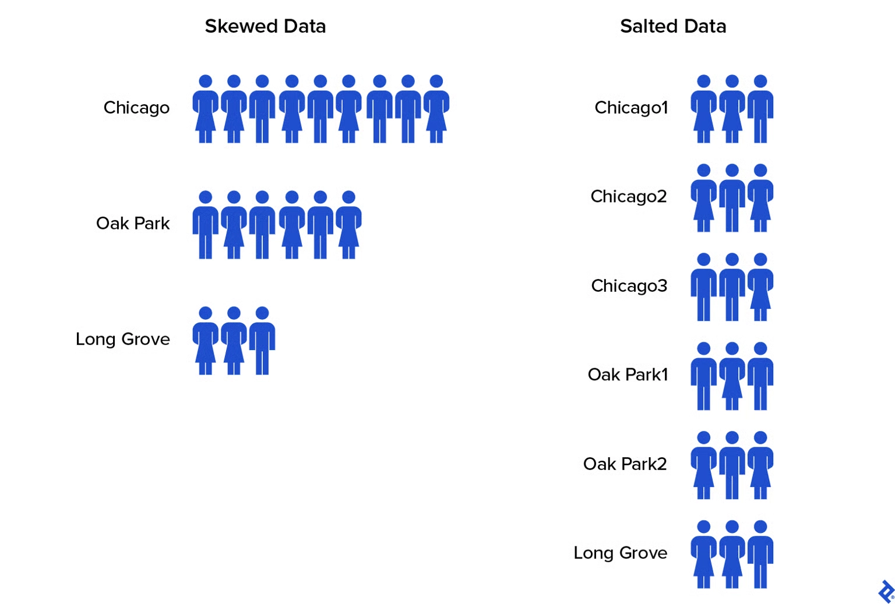

<br>

### Broadcasting

- join()은 두 개의 데이터셋이 하나 이상의 공통 키를 기준으로 결합되는 일반적인 작업이다. 지정된 열의 값을 매칭시킴으로써 서로 다른 두 데이터셋의 행들이 하나의 데이터셋으로 병합될 수 있다. 여러 노드에 걸친 데이터 셔플링이 필요하기 때문에, join()은 네트워크 지연 측면에서 비용이 많이 드는 작업일 수 있다.
- **작은 데이터셋이 더 큰 데이터셋과 조인되는 시나리오**에서, 스파크는 Broadcasting이라 불리는 최적화 기법을 제공한다.
- **두 데이터셋 중 하나가 각 워커 노드의 메모리에 들어갈 수 있을 만큼 충분히 작다면, 그것은 모든 노드로 전송될 수 있으며, 이는 비용이 많이 드는 셔플 작업의 필요성을 줄여준다**. join() 작업은 단순히 각 노드에서 로컬로 발생한다.

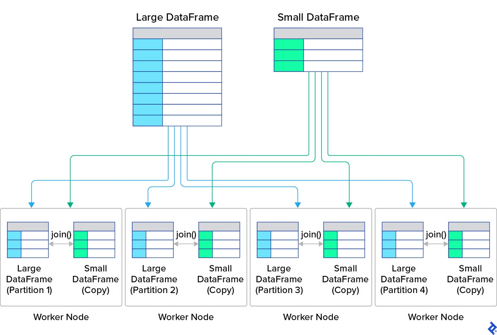

```python
from pyspark.sql.functions import broadcast
df1.join(broadcast(df2), 'id')
# must be small enough to fit into the memory of each worker node;
# a DataFrame that is too large will cause out-of-memory errors.
```

<br>

### Filtering Unused Data

- 고차원 데이터로 작업할 때, 계산 오버헤드를 최소화하는 것이 필수적이다. 반드시 필요하지 않은 행이나 열은 모두 제거되어야 한다. 계산 복잡도와 메모리 사용량을 줄여주는 두 가지 핵심 기법은 early filtering과 column pruning이다:
    - **Early filtering**: 필터링 작업은 데이터 처리 파이프라인에서 가능한 한 일찍 적용되어야 한다. 이는 후속 transformations에서 **처리해야 할 행의 수를 줄여주어**, 전체적인 계산 부하와 메모리 자원을 감소시킨다.
    - **Column pruning**: 많은 계산들은 데이터셋의 일부 열만을 포함한다. **데이터 처리에 불필요한 열들은 제거되어야 한다**. Column pruning은 처리되고 저장되어야 할 데이터의 양을 크게 줄일 수 있다.

<br>

**Filtering**

```python
df = df.select(“name”, ”age”).filter(df[”age”] > 21)

df = df.filter(df[”age”] > 21).select(”name”, ”age”)
```

- 밑에 것이 빠름

<br>


## Spark Web UI

### Spark Web UI

- driver는 일반적으로 포트 4040에서 시작하는 실시간 스파크 웹 UI를 노출한다.
- YARN에서는, Resource Manager나 Application Master proxy가 애플리케이션 UI 링크를 제공할 수 있다. 다른 클러스터 매니저들은 이를 다르게 노출한다.
- UI는 애플리케이션 수준의 jobs, stages, tasks, executors, storage, SQL plans, 그리고 runtime metrics를 표시한다.

<br>

### Spark History Server

- Spark History Server는 영속화된 이벤트 로그로부터 애플리케이션 UI를 재구성한다.
- 이벤트 로그가 사용 가능한 경우 완료된 애플리케이션과 미완료된 애플리케이션을 나열할 수 있다.
- 일부 실시간 전용 링크나 외부 로그는 더 이상 접근할 수 없을 수 있지만, job, stage, task, executor, storage, SQL events는 로그로부터 재생될 수 있다.

<br>

- ./sbin/start-history-server.sh
- 히스토리 서버
    - spark.history.fs.logDirectory hdfs://namenode/shared/spark-logs
- 스파크 애플리케이션
    - spark.eventLog.enabled true
    - spark.eventLog.dir hdfs://namenode/shared/spark-logs
- 히스토리 서버와 스파크 애플리케이션은 동일한 공유 이벤트 로그 위치를 사용해야 한다.

<br>

**스파크 이벤트 로그 검색하기**

- Amazon EMR에서는 먼저 환경 탭이나 스파크 구성에서 유효한 spark.eventLog.dir를 확인한다.
- 이벤트 로그 위치는 EMR 릴리스와 배포 유형에 따라 다를 수 있다. 클러스터 종료 후 접근을 위해서는, Amazon S3에 영속적 UI나 로그 아카이빙을 구성한다.

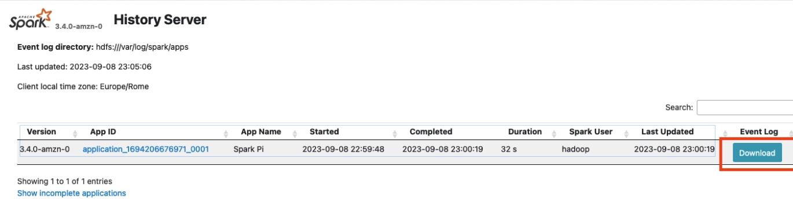

<br>

**스파크 웹 UI의 애플리케이션**

- 애플리케이션 지속 시간은 애플리케이션 시작부터 완료까지 경과된 시간을 측정한다.
- 이는 대략적인 비교에만 사용한다. 의미 있는 벤치마크 비교를 위해서는 동등한 입력 데이터, 코드, 스파크 구성, 그리고 클러스터 자원이 필요하다.

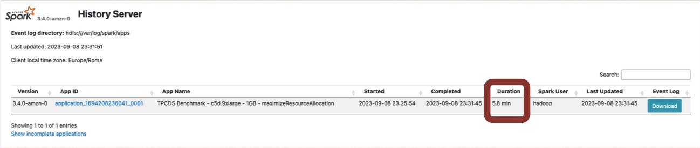

<br>


**Jobs in Spark Web UI**

- 지속 시간을 기준으로 작업을 정렬하여 비용이 많이 드는 작업을 식별한다.
- 개별 작업을 열어 그 스테이지와 DAG를 검사한다.
- 입력, 코드, 구성, 그리고 클러스터 자원이 통제된 경우에만 실행 간 작업을 비교한다.

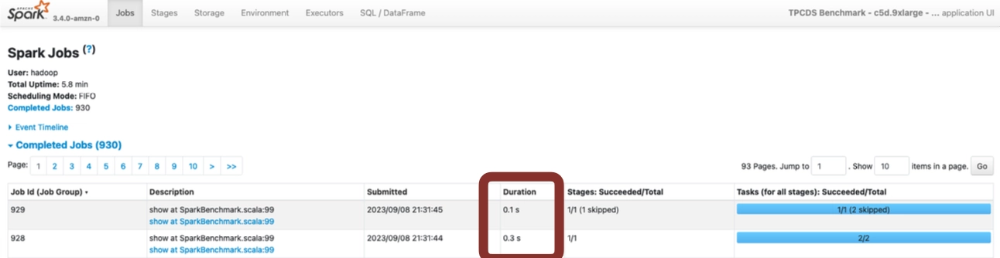

- **사용자**: 애플리케이션을 실행시킨 계정.
- **총 가동 시간**: 스파크 애플리케이션이 시작된 이후 경과된 시간.
- **스케줄링 모드**: 애플리케이션이 사용하는 스케줄러. 스파크는 기본적으로 FIFO를 사용하며 FAIR 스케줄링을 사용하도록 구성될 수 있다.

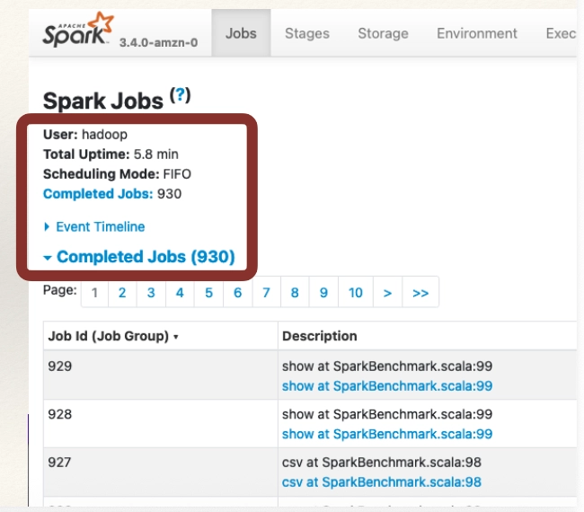

- 다음을 검토하기 위해 이벤트 타임라인을 확장한다:
    - 작업이 시작되고 완료된 시점
    - 익스큐터가 추가되거나 제거된 시점
    - 작업 사이의 유휴 간격
    - 동적 할당이나 클러스터 스케일링으로 인한 지연

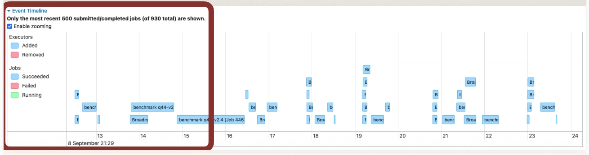

<br>

**Stages in Spark Web UI**

- 스테이지 탭은 애플리케이션 내의 모든 스테이지를 나열한다.
- 작업 탭에서 하나의 작업을 열어 그 작업에 속한 스테이지들만 볼 수도 있다.

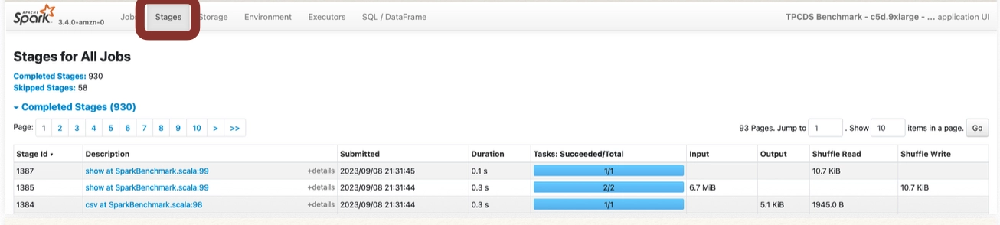

- 태스크 수준의 분포를 검사하기 위해 스테이지를 연다:
    - 지속 시간과 스케줄러 지연
    - 입력 및 출력 크기
    - 셔플 읽기 및 쓰기
    - GC 시간
    - 메모리 및 디스크 스필
    - 최대 실행 메모리

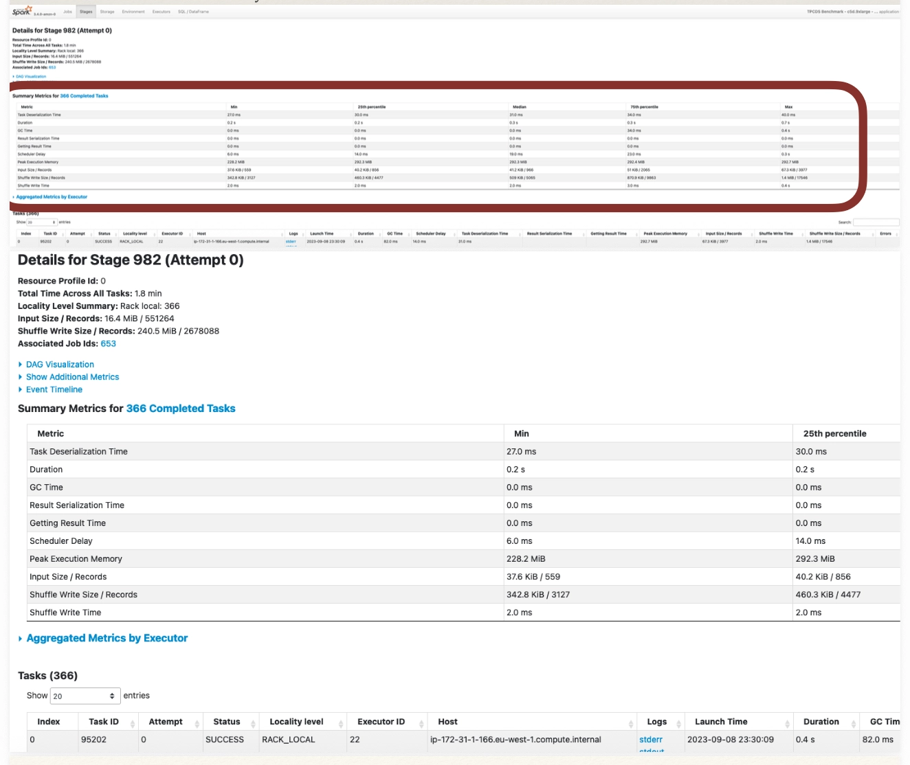

<br>


**Storage in Spark Web UI**

- 저장소 페이지에는 클러스터의 메모리나 로컬 디스크에 캐싱되거나 영속화된 RDD 블록에 대한 정보가 포함되어 있다. 이 페이지는 persist나 cache 작업을 명시적으로 호출한 경우에만 일부 세부 정보를 표시한다.

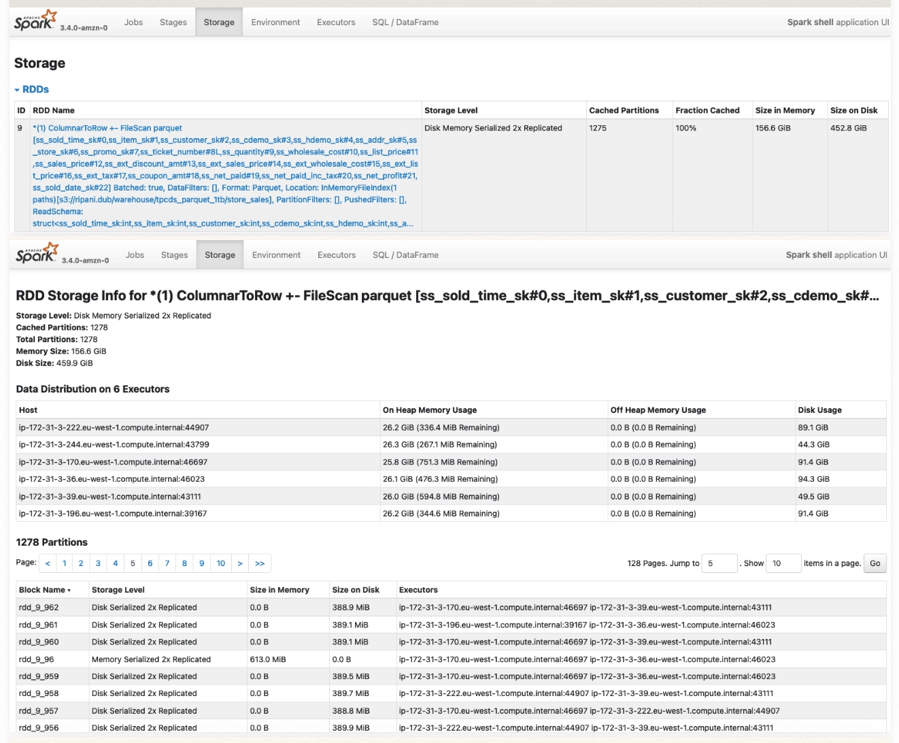

<br>

**Environment in Spark Web UI**

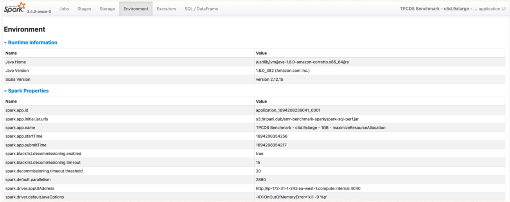

<br>

**Executors in Spark Web UI**

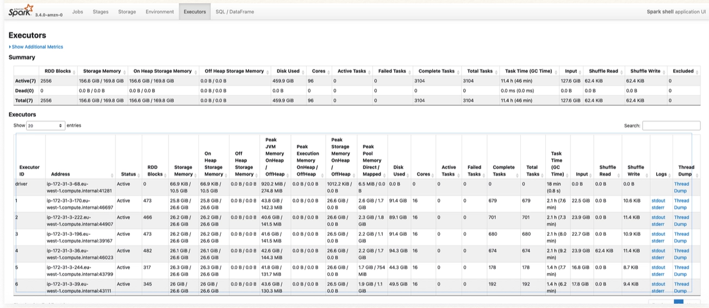

<br>

**SQL/DataFrame in Spark Web UI**

- SQL/데이터프레임 페이지는 스파크 애플리케이션에서 실행된 모든 스파크 쿼리를 요약한다.
- 이 페이지는 애플리케이션이 데이터셋이나 데이터프레임 스파크 API를 사용하는 경우에만 UI에서 볼 수 있다. (RDD API를 사용할 때는 표시되지 않는다)

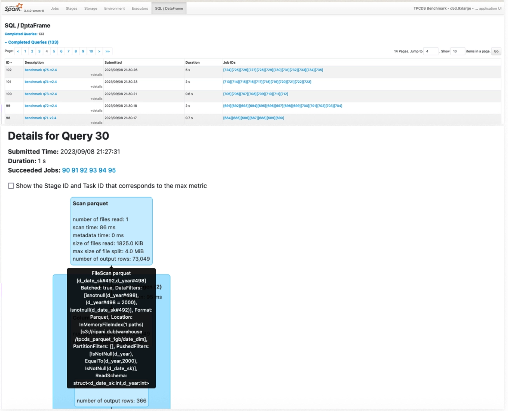

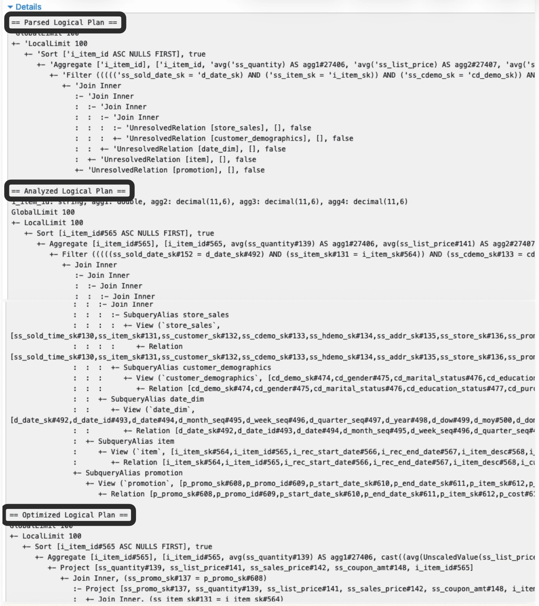

<br>

## When Data > Memory: How Spark Actually Works

### Why “Too Big for Memory” Isn’t a Show‑stopper

- 스파크는 한 번에 하나의 파티션을 처리하며, 전체 데이터셋을 램에 담을 필요가 결코 없다.
- 메모리가 부족하면, 연산자들은 spill하며, lineage는 안전한 재계산을 가능하게 한다.
- 중간 결과물은 셔플에서 또는 cache/checkpoint를 사용할 때만 구체화된다.

<br>

### Spark’s Unified Memory—Who Uses What, When

- 통합 풀은 실행(조인/정렬/집계)과 저장(캐시)으로 나뉜다.
- 실행은 저장을 eviction할 수 있으며, 저장은 여유 공간만 빌릴 수 있다.
- 저장 eviction은 캐싱된 블록에 대해 LRU 방식이다.
- 핵심 설정값: spark.executor.memory, spark.memory.fraction, off-heap.

<br>

### 스파크가 대용량 데이터를 읽는 방식: One Partition at a Time

- 태스크는 소스로부터 스트리밍하며, 캐싱하지 않는 한 저장 메모리는 관여하지 않는다.
- 더 많고 작은 파티션 → 더 높은 병렬성, 태스크당 더 낮은 메모리.
- 스테이지 내 파이프라이닝(WholeStageCodegen)은 중간 구체화를 방지한다.
- 파이프라이닝은 셔플, cache/checkpoint, 그리고 상태 유지 작업(정렬/집계/조인/윈도우)에서 멈춘다.

<br>

### Caching Rules that Actually Matter

- **LRU는 cache()/persist()를 사용할 때만 적용된다.**
- MEMORY_ONLY → 축출 시 폐기되며, 나중에 재계산된다.
- MEMORY_AND_DISK → 블록이 디스크에 기록되며, 필요할 때 다시 읽어들여진다.
- *_SER는 CPU 비용을 대가로 메모리 사용량을 줄인다.
- 캐싱해야 할 때:
    - 2회 이상 재사용되거나(다수의 액션/쿼리) 비용이 많이 드는 단계(셔플 이후, UDF, 윈도우 작업)에 사용될 때.
    - 캐싱되는 데이터가 작아지도록 먼저 축소한다(필터/셀렉트).
    - 메모리에 완전히 들어가지 않을 수 있는 경우 MEMORY_AND_DISK(_SER)를 선호한다.
- 캐싱 후: 즉각적인 재사용이 필요한 경우 선택적으로 저비용 액션으로 한 번 예열한다.
- 마지막 사용 후 **Unpersist**: 메모리를 확보한다; 임박한 고비용 스테이지의 경우, blocking unpersist를 사용한다.

<br>

### 파티션이 너무 클 때 발생하는 일

- 블록이 메모리에 캐싱되려면 저장 공간에 완전히 들어맞아야 한다.
    - MEMORY_ONLY: 블록이 캐싱되지 않는다
    - MEMORY_AND_DISK: 디스크에 저장된다.
- 해결 방법:
    - **repartition**(~128-256 MB)
    - spark.sql.files.maxPartitionBytes 조정
    - *_SER 사용.

<br>

### 연산자가 램을 소진했을 때: The Spill

- 외부 정렬과 셔플 집계는 중간 데이터를 로컬 디스크로 스필한 후 나중에 병합할 수 있다.
- 해시 기반 조인은 빌드 측 해시 테이블이 메모리에 들어맞아야 하며 일반적으로 스필에 안전하지 않다.
- 스테이지 UI에서, Memory Bytes Spilled, Disk Bytes Spilled, Peak Execution Memory, 그리고 태스크 지속 시간을 확인한다.

<br>

### Storage vs. Execution: Who Wins Under Pressure?

- 실행이 우선순위를 가지며 저장 블록을 eviction할 수 있다.
- 저장은 실행을 eviction할 수 없으며, 무거운 조인/정렬 중에 캐시가 줄어들 수 있다.

<br>

### 메모리 제한 하에서의 조인: 올바른 전략 선택하기

- 빌드 측이 모든 executor에 편안히 들어맞는 경우 **Broadcast Hash Join을** 선호한다.
- 대규모 동등 조인과 메모리 제약이 있는 워크로드에는 **Sort-Merge Join**을 선호한다.
- 각 빌드 측 셔플 파티션이 메모리에 들어맞을 만큼 충분히 작은 경우에만 **Shuffled Hash Join**을 사용한다. 이는 일반적으로 스필에 안전하지 않다.
- AQE skew-join handling, pre-aggregation, heavy-key 분할, 또는 salting으로 스큐를 완화한다.

<br>

### 복제 없는 결함 허용성: Lineage in Action

- Lineage는 손실된 파티션을 재계산한다.
- Persistence는 재계산 비용을 줄인다
    - *_AND_DISK는 캐싱된 블록에 대한 재계산을 방지한다.
- 깊은 lineage를 잘라내기 위해 체크포인팅을 사용한다.

<br>

### Tuning Knobs that Move the Needle

- Partitioning:
    - spark.sql.shuffle.partitions
    - spark.default.parallelism
    - repartition()/coalesce().
- 메모리:
    - executor memory
    - memoryOverhead
    - spark.memory.fraction
    - off-heap.
- Serialization:
    - **KryoSerializer**,
    - MEMORY_*_SER 캐시 수준
- I/O:
    - spark.sql.files.maxPartitionBytes
    - openCostInBytes.
- 참고 사항:
    - off-heap을 활성화하는 경우, 그에 맞게 executor.memoryOverhead를 높인다.

<br>

### See the Truth: Spark UI + explain("extended")

- UI: 스필 바이트, 최대 실행 메모리, 스큐 지표.
- Storage tab: 캐싱된 크기와 위치(메모리/디스크).
- Plans: explain("extended")는 조인/셔플과 물리적 계획을 나타낸다.

<br>

### Best Practices & Common Mistakes

- 해야 할 것
    - 작고 재사용되는 중간 결과물을 캐싱하고, 즉시 unpersist한다:
        - 재사용 기준: 2회 이상 참조되거나, 여러 액션/작업에 걸쳐 사용되거나, 재계산 비용이 많이 드는 경우.
        - 사용 공간을 줄이기 위해 축소(필터/셀렉트/프로젝션) 후 캐싱한다.
        - 수준 선택:
            - 작은 경우 → MEMORY_ONLY(_SER)
            - 크거나 불확실한 경우 → MEMORY_AND_DISK(_SER).
        - 즉각적인 재사용이 중요한 경우 한 번 예열하고, 마지막 사용 시 unpersist한다(대규모 조인/정렬 직전에 공간을 확보하는 경우 블로킹 방식으로).
    - 파티션을 균등하게 유지하고, 스큐를 조기에 해결한다.
    - 대규모 조인에는 SMJ를 선호하고, 들어맞는 경우에만 브로드캐스트한다.
  
<br>

- 하지 말아야 할 것
    - 대용량 데이터에 collect()를 사용하는 것
        - repartition(1).
    - "혹시 몰라서" 거대한 넓은 outputs을 캐싱하는 것.
    - UI의 spill metrics을 무시하는 것.

<br>

### Cheat Sheet: Quick Decisions in the Heat of Battle

- Oversized partition
    - files.maxPartitionBytes를 낮추거나 repartition() 사용
    - 캐싱에는 MEMORY_AND_DISK(_SER) 사용
- Heavy spill
    - 더 많은 파티션, 더 많은 메모리, 또는 다른 조인 방식.
- Cache thrash
    - 직렬화/디스크 수준 사용 또는 캐싱 중단.
- Join OOM risk
    - 브로드캐스트 임계값 조정
    - SMJ 선호
    - 스큐 해결.

<br>

### Summary

- **Read**: 파티션 단위 스트리밍.
- **Cache**: 블록은 완전히 들어맞아야 하며, persist 시 LRU를 통해 축출된다.
- **Execute**: 연산자들은 점진적으로 스필하고 병합한다.
- **Priority**: 압박 상황에서 실행이 저장을 축출한다.